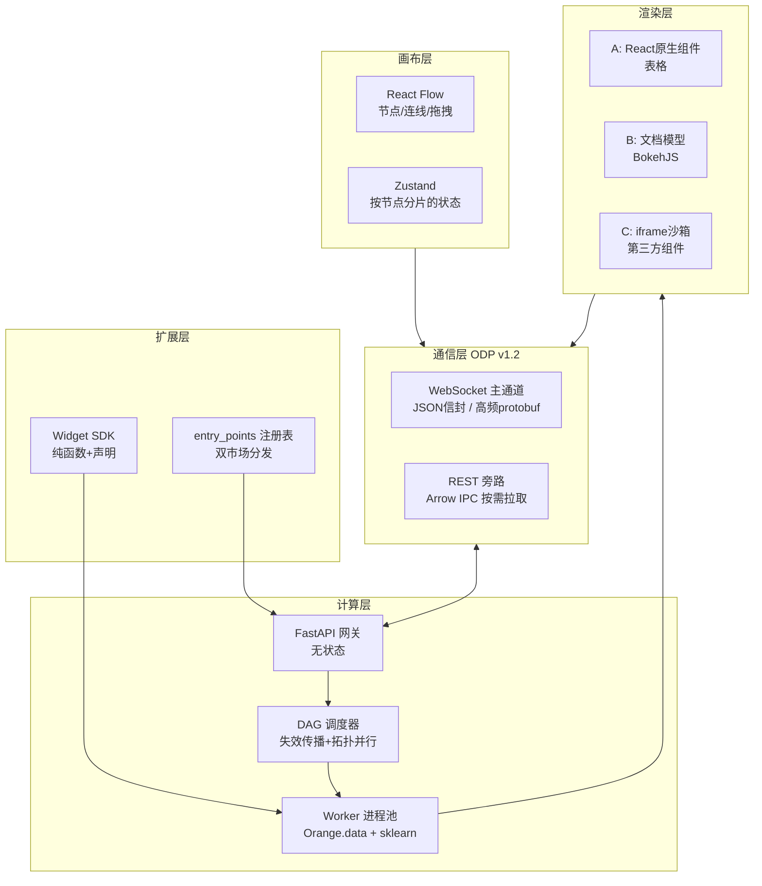
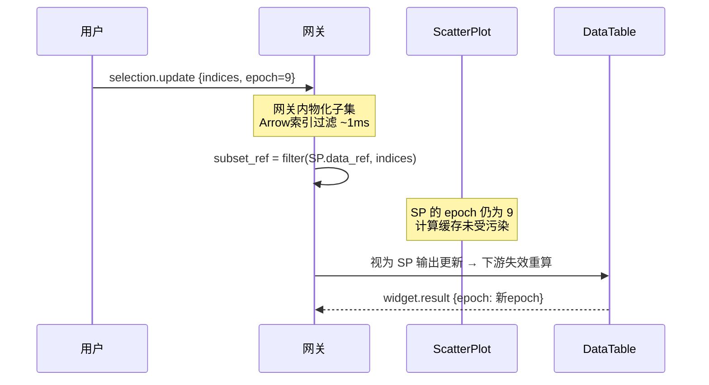
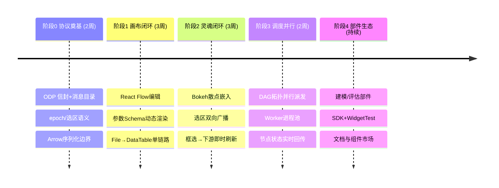

<p align="center">
    <a href="https://orange.biolab.si/download">
    
    </a>
</p>
<p align="center">
    <a href="https://orange.biolab.si/download" alt="Latest release">
        
    </a>
    <a href="https://orange3.readthedocs.io/en/latest/?badge=latest" alt="Documentation">
        
    </a>
    <a href="https://discord.gg/FWrfeXV" alt="Discord">
                                                                                                                                                                                                                                                          </a>
</p>

# Orange Data Mining
[Orange] is a data mining and visualization toolbox for novice and expert alike. To explore data with Orange, one requires __no programming or in-depth mathematical knowledge__. We believe that workflow-based data science tools democratize data science by hiding complex underlying mechanics and exposing intuitive concepts. Anyone who owns data, or is motivated to peek into data, should have the means to do so.

<p align="center">
    <a href="https://orange.biolab.si/download">
    
    </a>
</p>

[Orange]: https://orange.biolab.si/


**orange3-web 项目技术方案 v1.0——定位是“无头化 Orange 计算引擎 + Web 交互式数据挖掘画布”：不是给 Orange3 套一个 Web 壳（那只解决分发），而是把 Orange 的交互式数据挖掘体验作为第一性原理，重新设计其在 Web 架构下的承载方式。** 本方案以原理为主：每一条设计都从“体验本质”推导，每一个取舍都记录理由。
---
## 一、项目定位
### 1.1 解决的问题
Orange3 是交互式数据挖掘的黄金标准，但被 Qt 桌面架构锁死：部署需安装 1GB+ 客户端、无法多人协作、无法云端集成。既有的 Web 工作流平台（Dify、n8n）面向 LLM 编排与批处理，其“提交-执行-完成”模型承载不了框选传播式探索体验。
**orange3-web 的目标是：在浏览器里复现 Orange3 的交互式数据挖掘体验，同时保留 Python 数据科学生态的全部计算能力。**
### 1.2 非目标（同样重要）
- **不做 Orange 桌面版替代**——桌面端继续存在，Web 端是平行形态；
- **不做 LLM 工作流编排**——不与 Dify 类平台竞争；
- **不做低代码 ETL**——数据探索优先于数据管道。
### 1.3 体验定义（验收即体验）
Orange3 的体验可以精确刻画为三条可度量的交互语义：
| # | 体验 | 度量 |
|---|---|---|
| 1 | 调参数，下游立刻变 | 参数变更 → 下游全部刷新，延迟 ≤ 50ms（单机局域网） |
| 2 | 框选一批点，下游立刻只看这批点 | 选区广播端到端 ≤ 200ms |
| 3 | 框选不浪费算力 | 源部件计算缓存命中率在选区交互期间 = 100% |
**这三条是本方案存在的原因，后面所有架构决策都为它们服务。**
---
## 二、第一性原理
### 2.1 Orange 体验的本质是什么
剥掉 Qt 的外壳，Orange3 的交互模型由三个机制构成，它们才是要复刻的对象：
**机制一：参数即时传播。** 用户在任意部件改一个参数，失效沿 DAG 向下游传播、所有下游部件重算。用户无需点“运行”，改了就是跑了。
**机制二：选区双向广播。** 可视化部件既是消费者也是生产者——散点图上框选 30 个点，这个“30 行子集”就成为该部件对下游的输出，所有下游部件（表格、建模、评估）立即只看到这 30 行。多个选区生产者的结果按策略合并。
**机制三：数据引用传递。** 部件间传的是 `Table` 对象引用而非拷贝——同进程零开销、变更即时可见。这是前两条机制能“毫秒级”的物理基础。
### 2.2 Web 架构下的翻译
| Orange 桌面机制 | Web 翻译 | 原理 |
|---|---|---|
| 参数即时传播 | WebSocket 消息流 + epoch 失效传播 | 把“改了就是跑了”翻译为事件流驱动调度 |
| 选区双向广播 | `selection.update/broadcast` 消息 + 框架物化子集 | 选区是轻量索引（数百字节），广播成本与数据规模解耦 |
| 数据引用传递 | `data_ref` 引用 + Arrow 共享内存 | 同进程零拷贝语义在服务端等价保留，跨网络按需拉取 |
**核心洞察：这三条机制全部是“通信协议层”的问题，不是“渲染层”问题。** 画布用 React Flow 现成可搭，算法用 Python 生态现成可调——唯一需要从零设计的是承载这三条机制的协议。这也是本项目最大的技术资产。
---
## 三、总体架构
### 3.1 五层架构

各层一句话职责：
- **画布层**：只做结构编辑与参数收集，不碰数据；
- **通信层**：唯一通道，承载参数流、选区流、状态流；
- **计算层**：无 Qt 依赖的纯 Python，算法栈 100% 复用；
- **渲染层**：三种模式按数据规模与来源分流；
- **扩展层**：部件开发不写 GUI、不学框架，写纯函数。
### 3.2 与 Orange3 的资产关系
| 资产 | 决策 | 理由 |
|---|---|---|
| `Orange.data`（Table/Domain/Variable） | **复用** | 无 Qt 耦合，是十年沉淀的核心数据结构 |
| 算法栈（sklearn 及 Orange 分类/聚类/预处理） | **复用** | 无 Qt 耦合 |
| `.ows` 工作流格式（纯 XML） | **兼容** | 桌面端工作流可直接导入 |
| entry_points 部件发现 | **复用机制、重建内容** | 机制成熟，但旧部件无法直接迁移 |
| `OWWidget` 继承链 + `gui` 控件库 | **弃用** | 继承 QWidget，深度耦合，是无头化的根本障碍 |
| pyqtgraph / QTableWidget 渲染 | **弃用** | 无可提取的计算逻辑，整体重写 |
**这决定了项目策略：计算资产全保，交互层重建。** 300+ 存量部件按使用频率迁移（首批 File / Data Table / Scatter Plot / Test and Score 等高频 20-30 个），SDK 生态靠增量发展。
---
## 四、核心机制原理
### 4.1 ODP 协议：连续流而非事务
**原理陈述：批处理协议把“变化”建模为一次事务（提交→阻塞→完成），ODP 把变化建模为连续流——参数流、选区流、状态流在同一 WebSocket 长连接上多路复用。**
消息信封携带 `cid`（事务 ID，客户端生成）+ `seq`（服务端流序号），三条不变式构成协议的正确性根基：
1. **数据引用不变式**——消息载荷只允许 `data_ref` + 摘要，数据本体永不进主通道；
2. **世代单调不变式**——每部件维护单调递增 `epoch`，任何结果必须携带计算所基于的 epoch，`msg.epoch < current` 一律丢弃；
3. **选区轻量不变式**——选区只是压缩行索引（数百字节），永不展开为数据。
**epoch 的设计辩护**：Streamlit 的缓存用内容哈希判命中，遇到不可哈希对象（数据库句柄、C 扩展对象）即漏判错判。epoch 是单调计数器而非内容函数，从机制上免疫这类问题——代价是放弃了“同参数即同结果”的自动去重，由输出槽缓存以 `(node_id, epoch)` 键补足。
### 4.2 参数风暴的正确性：丢弃规则
用户快速调参 A→B→C（epoch 8→9→10），乱序返回的旧结果必须被静默丢弃：
```typescript
// 前端应用的唯一守卫
if (msg.epoch < state.epoch) return state;  // 迟到的旧结果，丢弃
```
后端调度器同理：派发 Worker 前校验 epoch，过期任务不进池。**这是参数风暴下结果正确性的全部机制**——没有取消令牌的复杂协调，只有一条单向比较规则。
三级风暴抑制叠加在丢弃规则之上：前端 300ms debounce（滑条拖动合并）、网关 100ms 合并窗口（同参数键只留最新）、调度器结果去抖（同节点 computing 中新请求置 pending）。
### 4.3 选区派生输出：本方案最关键的性能机制
**原理陈述：选区不触发源部件重算，只触发视图物化。**
散点图的计算（坐标映射、聚合）与选区无关，框选重跑部件纯属浪费。把“选中子集”建模为框架托管的派生输出：

规则细目：源部件 epoch 不变、下游 epoch 正常递增、子集物化在网关进程内毫秒级完成、多选区生产者按部件声明的 `selection_policy`（`intersect/union/latest_wins`）合并、**源数据换代即清空选区并广播 `selection.cleared`**。
**这就是验收标准第 3 条（框选期间源部件缓存命中 100%）的实现保证**——Orange 交互体验的服务端性能下限由此托底。
### 4.4 数据传输：三级策略 + 零拷贝
| 级别 | 内容 | 通道 | 时机 |
|---|---|---|---|
| L0 内联 | 摘要 + ≤20 行预览 | WebSocket 消息内 | 每次 result 随发 |
| L1 按需 | 任意行区间 | REST + Arrow IPC 分页 | 用户打开全表视图 |
| L2 流式 | 服务端渲染产物 | REST | 大数据可视化 |
节点间数据统一 Arrow 列式：Worker 进程间共享内存零拷贝（内存算），Parquet 持久化（盘上存），`Orange.data.Table ↔ Arrow` 的序列化边界封装在 Worker 侧（domain 语义随 schema 同步，离散值集合不丢）。
### 4.5 渲染层：三模式 + 差量更新
按数据规模与来源分流的渲染策略：
- **模式 A（React 原生）**：表格等核心交互组件，AG Grid 虚拟滚动，百万行级流畅，运行在主应用内零桥接开销；
- **模式 B（文档模型）**：服务端聚合/降采样产出 Bokeh/Plotly 文档 JSON，前端渲染引擎执行——大数据可视化的主路径；
- **模式 C（iframe 托管）**：第三方组件沙箱，库冲突隔离 + 崩溃隔离 + 不受信代码隔离。
两条铁律（从 Streamlit 的坑反推，写入协议实现要求）：
1. **iframe 常驻不重建**——同一 widget_id 的跨 epoch 更新必须原地替换文档内容，iframe DOM 实例永不销毁。Streamlit 组件收到新参数即重建 iframe 的闪烁问题，从协议层禁绝；
2. **epoch 内更新走 `render.patch`**——选区高亮、悬停这类微调只发差量指令（`select/attr/data/add/remove` 五操作 + `custom` 逃生舱包装库原生 patch），不发渲染产物全量。
安全边界：iframe `sandbox="allow-scripts"`、postMessage 严格 origin 白名单、**iframe 不持有会话凭证**（短时效 scoped token，跨会话重放即失效）。
### 4.6 Widget SDK：纯函数 + 声明
**原理陈述：写部件 = 写一个纯计算函数 + 一份声明。没有 Qt、没有 GUI 代码、没有框架知识。**
```python
@widget(
    id="std.scatter-plot",
    inputs=[Input("data", types=["table"])],
    outputs=[Output("selected_data", types=["table"], derived="selection")],
    params=[Param("x", type="column"), Param("y", type="column")],
    selection=SelectionBehavior(produces=True),
)
def run(ctx):
    table = ctx.input("data")
    ctx.set_render(ChartSpec.scatter(x=ctx.param("x"), y=ctx.param("y"), source=table))
```
三个关键设计：
- **`derived="selection"` 声明派生输出**——选区子集由框架物化，部件作者零负担（4.3 机制对开发者不可见）；
- **`Param(type="column")` 是绑定输入 schema 的动态参数**——前端参数面板从上游 `data_ref` 的 schema 自动生成列下拉，Orange `context_settings` 的“参数随数据自适应”难题由此无头化解决；
- **Context API 刻意保持极小**（`input/param/output/set_render/progress/log` 六个方法）——每个 API 可单测、可 mock，这是对 `OWWidget` 数十个方法的历史包袱的釜底抽薪。
配套 WidgetTest 测试框架（借鉴 Streamlit AppTest 的模式、规避其覆盖缺口教训）：`ChartSpec` 每个构造器从第一天必须有测试覆盖，此为 SDK 贡献门槛。
---
## 五、关键决策记录
方案演化中做出并记录的取舍，每条附理由：
| # | 决策 | 备选 | 为什么选它 |
|---|---|---|---|
| D1 | 自建协议层，不用 Dify/n8n 做底座 | 在 LLM 工作流平台上加节点 | 其协议为批处理事务模型，节点间传 JSON 全量、无用户介入点，承载不了选区传播式交互【前期评估结论】 |
| D2 | 后端保留 Python，不用 Pyodide 浏览器内计算 | 纯前端方案 | 4GB 内存硬上限 + Wasm 单线程 + 无 PyTorch，交互式挖掘会被卡死在玩具规模；Pyodide 仅留作轻量演示模式 |
| D3 | 本地后端为主，进程隔离 Worker | — | C 扩展崩溃隔离、GIL 争用隔离；网关永不受 Worker 段错误影响 |
| D4 | epoch 单调计数，不用内容哈希 | 参数哈希缓存 | 免疫不可哈希对象问题（Streamlit 的实际教训）；去重由输出槽缓存补足 |
| D5 | 数据走 REST 旁路，不进 WebSocket | 全走主通道 | 几十 MB 载荷会阻塞心跳、放大重连重放成本、破坏背压；旁路可并行、可缓存 |
| D6 | iframe 常驻 + postMessage 差量 | 组件参数变更即重建 | Streamlit iframe 重建的闪烁/滚动丢失问题的协议层禁绝 |
| D7 | 服务端会话表为唯一状态权威 | 前后端状态对等双写 | Streamlit widget state + session_state 双写的同步错乱教训；前端 Zustand 是带 epoch 校验的乐观缓存 |
| D8 | 重连恢复靠快照对账，不靠消息全量重放 | 事件溯源全重放 | 重放只补 state/result 事件（有界环形缓冲 1000 条），参数与选区以服务端快照为准——务实折中 |
| D9 | 计算资产复用、交互层重建 | 迁移 OWWidget 逻辑 | `OWWidget` 继承 QWidget，计算逻辑寄生在 Qt 对象生命周期上，`__init__` 里的 GUI 构造无法无头复用 |
| D10 | 纯函数 SDK，不搞 GUI 外壳适配层 | 写 Qt stub 遮蔽旧部件 | stub 方案脆弱（Qt 属性访问即崩），只配做 PoC；长期架构必须是逻辑/GUI 分离 |
---
## 六、演进路线

**阶段 2 是 MVP 的灵魂——选区传播闭环跑通之日，产品价值主张即立住**（三条验收标准第 2、3 条同时成立）。之后的每一阶段都在拓宽宽度，不再增加架构深度。
**远期预留（不进 v1）**：协作编辑将画布结构升级为 Yjs CRDT 文档（消息类型不动，叠加层）；多租户横向扩展由网关无状态化 + sticky routing 承接（会话表外置 Redis）。
---
## 七、验收体系
### 7.1 性能硬指标及监控映射
| 指标 | 目标 | 监控指标（每个架构承诺配一个可报警的数字） |
|---|---|---|
| 参数传播延迟 | ≤ 50ms | `widget.param.update` → `widget.result` 的 P50/P99 |
| 选区广播端到端 | ≤ 200ms | `selection.update` → `selection.broadcast` 延迟 |
| 参数风暴正确性 | 零错序应用 | epoch 丢弃率（丢弃是正常，错序应用是事故） |
| 增量计算收益 | 高命中 | 输出槽缓存命中率 |
### 7.2 时序陷阱清单（协议正确性回归用例）
12 条场景覆盖全部竞态陷阱，摘要最关键的四条：
- **滑条风暴 5→10→20**：仅最终 epoch 结果被应用，中间结果静默丢弃；
- **框选后立刻改参数**：先到的 patch 因 epoch 淘汰被丢弃，数据换代广播 `selection.cleared`；
- **iframe 内组件抛异常**：节点降级占位，画布与其余节点存活；
- **断线期间对端完成计算**：resume 后快照携带最新 epoch 与 data_ref，无需重放。
---
## 八、结语：这个项目的本体是什么
回望整个设计历程，答案已经清晰：
**画布是界面，协议才是本体。** React Flow 换成别的画布库、Bokeh 换成别的渲染库，方案依然成立——因为 orange3-web 的技术内核是 ODP 这条永不空闲的双向流：参数流、选区流、状态流多路复用，靠 epoch 维持因果序，靠 `data_ref` 让数据引用穿越网络，靠框架物化让框选毫秒级传导而计算缓存安静如初。
批处理工作流把变化建模为事务；orange3-web 把变化建模为流。**这就是“交互式数据挖掘”在 Web 架构下的全部技术内容——把它一行行写出来，就是本方案的实施。**

